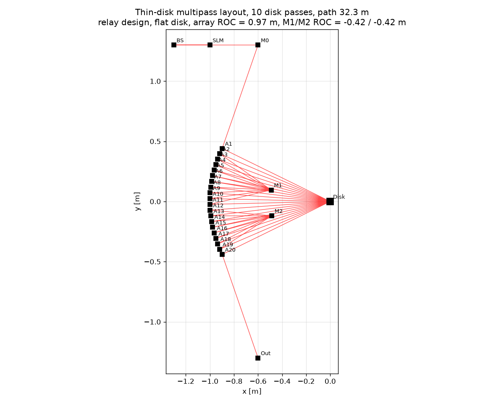
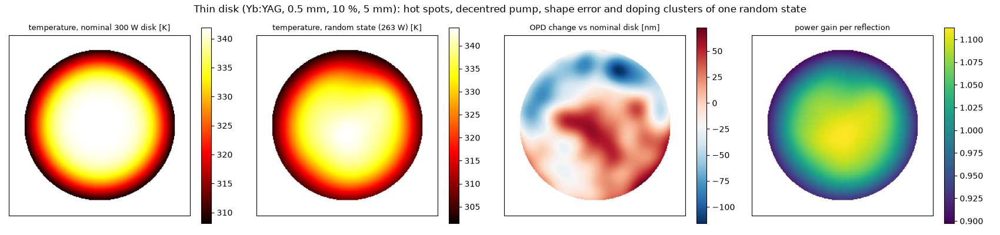
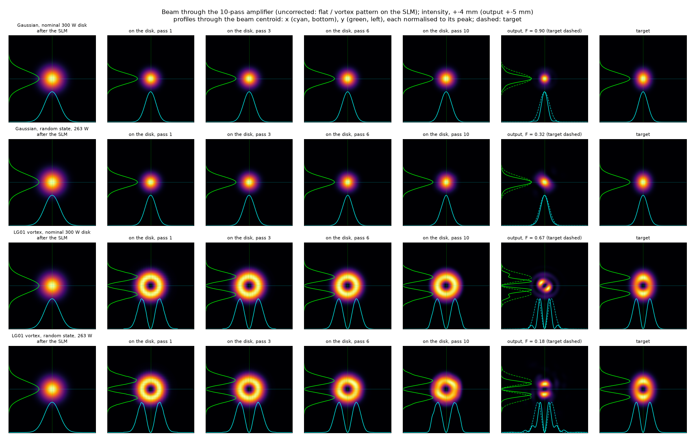
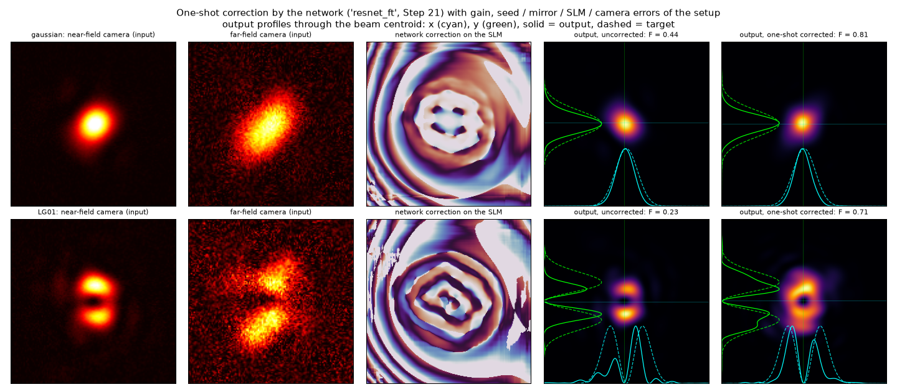

# Thin-Disk Laser Simulation

Physically detailed simulation of a Yb:YAG thin-disk 10-pass amplifier with an LCOS SLM in front,
built to test whether the distortions of structured light (Gaussian and LG01 vortex) in the
amplifier can be pre-corrected in **one shot** by a neural network, instead of an iterative loop.

```
Simulation_Code/           Python source, one module per physical part / step (see Modules)
Simulation_Code/checks/    numerical and physical diagnostics (see its README)
pipelines/                 shell scripts for the long GPU runs (dataset, training, evaluation)
Data/                      measured and placeholder input data
Results/                   figures, tables and trained networks, one folder per step
SYSTEM_PARAMETERS.md       the parameters of the modelled system
```

Datasets (`*.npz`, shards, caches; 1-10 GB per step) are not in the repository; they are
regenerated by `nn_dataset.py`. Trained networks are kept (`Results/<step>/<name>/model.pt`).

## The modelled laser system

A CW Yb:YAG seed at 1030 nm is shaped by a phase-only LCOS SLM and amplified in 10 passes over a
pumped Yb:YAG thin disk. The routing follows the PSI/ETH multipass design: a beam splitter sends the
seed to the SLM and back, M0 brings it onto a 20-mirror array, and each disk pass goes array mirror ->
disk -> array mirror, with the end mirrors M1/M2 linking consecutive passes. Every disk-to-disk unit is
a -I relay, so the disk is imaged onto itself pass after pass.



| part | model |
|---|---|
| seed | 1030 nm, 0.1 W, collimated Gaussian, 1.0 mm radius (~1.1 mm on the disk) |
| SLM | Hamamatsu X15213 LCOS: 12.5 µm pixels, 1272 × 1024, 8 bit, fill factor 0.96, R = 0.97, fringing crosstalk |
| amplifier | 10 disk passes, 20 array mirrors (R = 1.0 m) on a 1 m arc, end mirrors M1/M2, path 32 m; relay retuned once to the hot 300 W disk |
| disk | Yb:YAG, 0.5 mm thick, 5 mm diameter, 10 at.% doping, AR front / HR back, diamond heat sink |
| pump | 300 W at 969 nm over the whole disk (flat top, 2.5 mm radius); 240-360 W in the wide range |
| disk physics | temperature field with T-dependent conductivity, dn/dT, front-face bulge, disk/heat-sink bending (calibrated on Schuhmann et al. 2016), hot spots, decentred pump, shape error, 3-D doping clusters, quasi-three-level gain |
| propagation | scalar angular spectrum, 512 × 512 grid with 25 µm pixels (checked on 12.5 µm), absorbing boundaries |
| diagnostics | near-field camera (50 µm pixels) and far-field camera (f = 1 m lens, 25 µm pixels), 12 bit with noise; 5 pyrometer points; pump power meter |
| lab imperfections (Steps 20-21) | seed aberrations and pointing, relay-mirror tilts, SLM phase-stroke error, camera shift / rotation / scale / gain, far-field defocus |

All values with their sources are in [SYSTEM_PARAMETERS.md](SYSTEM_PARAMETERS.md).

**One disk state.** Temperature of the nominal disk and of one random state (263 W, hot spots,
decentred pump, shape error, doping clusters), the change of the optical path it causes and the
small-signal gain per reflection:



**Beam examples.** A Gaussian and an LG01 vortex through the amplifier without correction. The vortex
phase is imprinted by the SLM and the ring forms on the way to the disk. On the nominal disk the
output is close to the target; the random disk state shears and splits it after 10 passes
(F = field fidelity with the target). The curves are the x (cyan) and y (green) intensity profiles
through the beam centroid, each normalised to its peak; dashed: the target:



**One-shot correction.** The same disk state with the imperfections of a lab setup. The network sees
the two camera images (left), puts one phase pattern on the SLM (middle) and the output is corrected
without iteration (output profiles as above, dashed = target):



The figures are made by `Simulation_Code/readme_figures.py`.

## Main results (Steps 18-21)

100 fresh disk states per range, field fidelity through the real LCOS model, mean, Gaussian / LG01.
"Ceiling" = best phase-only pattern with the true disk state known (gradient optimisation at 50 µm,
scored on the 12.5 µm grid).

| range | uncorrected | network, one shot | ceiling |
|---|---|---|---|
| narrow: 300 W ±5 %, hot spots, decentre, shape, doping (Step 18) | 0.64 / 0.36 | 0.92 / 0.80 | 0.94 / 0.86 |
| wide: 240-360 W (Step 19) | 0.43 / 0.21 | 0.87 / 0.71 | 0.84 / 0.73 |
| wide + gain + lab nuisances, fixed per setup (Step 21) | 0.36 / 0.17 | 0.70 / 0.54 | 0.83 / 0.72 |

Iterative baselines (narrow range, nominal power): response-matrix loop with two-camera field
retrieval 0.80 / 0.59 after ~240 frames (Step 16), SPGD as in the slides 0.41 / 0.15 after ~390
frames (Step 14). The network uses two camera frames, five pyrometer points, the pump power and the
known doping map; the cameras carry the information (cameras only: within 0.01). Robust to 1 %
pump noise, 2 % pump drift and 3 % camera noise (≤ 0.02). Open: the gap with lab nuisances
(Step 21b running: wider network with the setup's reference images) and a sim-to-real test.

## Setup
```
python3 -m venv .venv
.venv/bin/pip install -r requirements.txt
```
The network steps need a CUDA GPU (developed on an RTX 2080 SUPER, 8 GB).

## Modules
- `seed_beam.py` – seed beam generator (Gaussian, Hermite-Gaussian, Laguerre-Gaussian,
  donut/vortex, top-hat). Produces complex field = amplitude + phase map.
  Run `.venv/bin/python Simulation_Code/seed_beam.py` for a demo figure in `Results/1_seed_beam/`.
- `propagation.py` – angular-spectrum propagation in vacuum / air / glass / Yb:YAG,
  optional transverse index map `dn(x,y)` (thermal lens) via split-step, Fresnel interfaces.
  Every step applies an absorbing super-Gaussian window at 86 % of the half-size of the grid
  (`absorber`, added 2026-11-03): the FFT is periodic, and without it light scattered beyond the
  window wrapped around and interfered with the beam (a fine raster in the output images, up to
  0.9 % of the power; fidelities change by < 0.04). `correction.Prop` and `gpu.py` use the same
  window with the exact transpose in the adjoint. Results before Step 20 were computed without it.
  Run `.venv/bin/python Simulation_Code/propagation.py` to check against the analytic Gaussian.
- `optics.py` – thin-element components: `aperture`, `ideal_lens`, `spherical_lens`,
  `mirror` (flat/curved, oblique incidence, reflectivity), `beam_splitter` (output coupler).
  Phases come from exact geometry, so spherical aberration and astigmatism appear naturally.
  Run `.venv/bin/python Simulation_Code/optics.py` for checks against ABCD results.
- `media.py` – transitions between media: Snell refraction, Fresnel s/p coefficients
  (Brewster, total internal reflection), footprint stretch at oblique incidence, curved
  refracting surfaces, and a tilted plane-parallel `plate`.
  Run `.venv/bin/python Simulation_Code/media.py` for checks against Fresnel/ABCD results.
- `thin_disk_system.py` – passive model of the full multipass system (BS/SLM arm, M0,
  mirror array, end mirrors M1/M2, flat thin disk from `disk.py`); same beam routing as the
  PSI/ETH design (Schuhmann et al. 2015). `DESIGN = "relay"` makes each disk-to-disk unit a
  -I (4f) relay, `DESIGN = "fourier"` an optical Fourier transform (unfolded stable resonator,
  mode-matched seed with spot `W_DISK` on the disk, first-order insensitive to the thermal
  lens). Default is the confocal Fourier design: flat array mirrors, M1/M2 concave with
  R = 2 (L1 + L2) ≈ 3 m, 0.70 mm spot on the disk, ~1 mm on M1/M2, no tight foci. Mirror radii
  are solved from the geometry in `design_mirrors()`; the script prints an ABCD table of the
  sensitivity to a thermal disk curvature. Produces `Results/5_system/system_layout.png`,
  `system_beam_radius_<pattern>.png` (vs ABCD), `system_beam_snapshots_<pattern>.png` and
  `system_in_vs_out_<pattern>.png` for each SLM pattern.
- `slm.py` – physical LCOS phase-only SLM: pixel pitch, 2π wrapping, grey levels,
  fringing-field crosstalk, fill factor / dead space, active area, reflectivity, diffraction
  order selection. Pattern helpers: `flat`, `vortex`, `lens`, `zernike_astigmatism`,
  `top_hat_shaper`. Run `.venv/bin/python Simulation_Code/slm.py` for efficiency checks.
  Needs Grid.dx <= pitch/2, e.g. `Grid(n=1024, size=10.24e-3)`. `SLM.stroke` scales the displayed
  phase (look-up-table error, used by the realism layer of Step 20).
- `slm_correction.py` – closed-loop wavefront correction: a seed with Zernike aberrations
  and amplitude ellipticity is measured at the SLM plane and corrected back to a Gaussian,
  then compared with the uncorrected beam through the full system (`Results/6.5_slm_correction/`).
- `disk.py` – physical Yb:YAG thin disk: 0.5 mm, curved AR front face, curved HR back face
  inside the crystal, unpumped ground-state absorption (no gain yet). Checked against
  Coddington, ABCD and the loss budget (`Results/7_disk/`).
- `thermal.py` – temperature field of the pumped disk (axial conduction to the heat sink through a
  contact resistance, radial spreading), temperature-dependent k, α, dn/dT (literature values,
  slopes and the contact conductance are marked PLACEHOLDER), and the resulting deformation:
  front-face bulge, bending of the disk/heat-sink composite (Timoshenko bimaterial plate, heat
  sink diamond/copper/CuW selectable; calibrated against the measured -0.009..-0.017 dioptres per
  kW/cm² of Schuhmann et al. 2016), dn/dT path -> reflection OPD map used by `ThinDisk`.
  The bending uses the azimuthal average of the thermal field (fixed 2026-11-01: earlier it used the +x
  profile only, which made non-axisymmetric hot spots change the thermal lens arbitrarily). Numbers
  in `Results/13_limits`, `14_spgd_final/before_thermal_fix/` and `16_two_camera/before_thermal_fix/`
  predate the fix; the static baselines of Steps 14 and 16 were rerun afterwards.
- `thermal_study.py` – runs the multipass with the hot disk for several pump powers
  (`Results/8_thermal/`).
- `thermal_transient.py` – OPD after a temperature change: pump switch-on / switch-off transients
  (1-D heat diffusion through the thickness), heat-sink temperature sweep, and the multipass
  output at instants after switch-on (`Results/9_thermal_transient/`).
- `thermal_noise_gif.py` – animation of the output intensity and phase while the disk is
  distorted by a fluctuating heat load (`Results/9_thermal_transient/beam_thermal_noise.gif`).
- `thermal_oscillation_gif.py` – the whole disk follows an oscillating, noisy heat load through its
  thermal inertia; animation of crystal temperature, OPD and output beam
  (`Results/9_thermal_transient/beam_thermal_oscillation.gif`).
- `thermal_experiment_gif.py` – expected camera view with realistic pump noise only (1.5 % fast,
  3 % slow drift): traces, intensity, phase and difference from the time average
  (`Results/9_thermal_transient/beam_experiment_noise.gif`).
- `correction.py` – Step 10: the amplifier from the SLM to the output as a linear operator with an
  exact adjoint (propagation, phase screens, flips, apertures, footprint stretch as a matrix);
  alternating-projection search for the physics-optimal phase-only SLM pattern; ideal
  complex-amplitude modulation and its realisation on the LCOS with a blazed carrier whose depth
  encodes the amplitude (Davis encoding, `depth` argument of `SLM.modulate`). `Amplifier.set_gain`
  replaces the per-reflection gain map (built with `DISK.gain` set), `set_mirror_tilts` tilts the
  relay mirrors by name (a reflection deviates by twice the tilt).
- `correction_benchmark.py` – upper bound of pre-correction: four target modes (Gaussian, LG01,
  HG10, top-hat) × five distortions (none, 400 W thermal lens, static disk shape error, hot spots,
  all) → output fidelity for naive / phase-only optimal / complex Davis patterns and the power
  cost of the complex encoding (`Results/10_correction/`).
- `correction_scan.py` – companion of the benchmark: scans the scale of the back-projected input
  field and plots SLM-plane overlap vs. power efficiency (`fidelity_vs_efficiency.png`); also prints
  the size of the field the SLM would have to deliver compared with the seed.
  Result for the 10-pass −I relay (presentation parameters): with 400 W thermal lens the required
  input field is ~4× wider than the 1.5 mm seed (the defocusing lens accumulates over the 10 relay
  passes and acts in both directions), so neither phase-only nor complex modulation can restore the
  target (best 0.25 / 0.55 for a Gaussian). Hot-spot/aberration-type distortions without the
  quadratic part are correctable (0.6 phase-only, 0.97 complex). The quadratic thermal lens must be
  taken out by the relay optics (M1/M2 radii, `thermal_sensitivity`) before the SLM can do its job.
- `limits_benchmark.py` – Step 13: operating limits of the pre-correction for the system of the slides.
  Four sweeps run as separate processes (`python limits_benchmark.py power_cold|power_hot|residual|pump_spot`,
  then `plot`): pump power with the relay as built and with the relay re-tuned to the hot disk
  (`retuned_mirrors`: even/odd array radii and M radius solved so that one unit including the
  thermal lens is -I), residual distortions at 300 W (hot spots, shape error, 3-D doping, 50 Hz pump
  modulation) and pump spot radius vs the 1.7 mm beam. Results and `LIMITS.md` in `Results/13_limits/`.
  Main finding: the limit is the pump spot, not the pump power. Outside the pumped area only the
  bending term remains, so the OPD has a kink at the pump edge; with a 2 mm pump and a 1.7 mm beam the
  wings are scattered over 10 passes and no SLM pattern can undo it (0.4 phase-only at 300 W even with
  the relay re-tuned). With a pump radius >= 3 mm (beam/pump <= 0.55) or a softer pump edge the same
  300 W is corrected to 0.8-0.9 phase-only and 0.93-0.99 with complex encoding.
- `spgd.py` – Step 14: the feedback algorithm of the slides (SPGD, Opt. Lett. 40, 1197 (2015)):
  Zernike-parametrised SLM phase, random parallel perturbation of all coefficients, metric =
  correlation of the CCD image with the target image (or the complex field overlap when the field is
  measured), update rule of slide 7 (accept if better, else scaled reverse step) or the classic
  two-sided rule; `Camera` model (binning, blur, noise, quantisation). The plant is any
  `measure(phase_map) -> image` function, so the same loop can drive the lab hardware.
  `python spgd.py` runs a self-test on a toy aberration (`Results/14_spgd/spgd_selftest.png`).
- `spgd_demo.py` – the loop on the simulated amplifier at the agreed operating point (whole-disk
  pump, 300 W, re-tuned relay, shape error + 10 % hot spots), targets Gaussian and vortex, real LCOS.
- `spgd_test.py` – test of the feedback loop with a minimal experimental zone: scenarios static,
  temp_noise (1 % pump/temperature noise per frame), temp_drift (+2 % over the run), jitter (10 urad
  pointing, 0.03 rad SLM flicker, 2 % camera noise) and all; the disk OPD is updated every camera frame
  through one shared phase screen. Reports correlation and true field fidelity against the
  physics-optimal pattern (`python spgd_test.py reference | <scenario> [iterations] | plot`,
  `Results/14_spgd/SPGD_TEST.md`).
- `gain.py` – Step 15: quasi-three-level small-signal gain of the disk as a per-reflection gain map
  G(x, y) = exp(2 [sigma_e N2 - sigma_a(T) (N_col - N2)]) with N2 from the absorbed pump of the
  thermal model, the column-integrated (3-D) Yb density and the temperature-dependent re-absorption
  (Boltzmann, 612 cm^-1). `ThinDisk.gain` / the operator chain apply sqrt(G) at every reflection.
  `python gain.py` prints the gain vs pump radius table (transparency at ~0.9 kW/cm^2).
- `gain_study.py` – amplification of the Gaussian and vortex seed with the pump over the whole disk,
  uniform vs 3-D clustered doping (+-2 %), with gain maps, outputs and residuals (`Results/15_gain/`).
  Whole-disk pumping at 300 W (0.27 kW/cm^2) is below transparency: x0.35 after 10 passes; the slides'
  x2.5 corresponds to a pump radius of 2.5-3 mm. Doping clusters change the gain by < 0.1 % but the
  index term (dn/dc) gives ~10 nm rms OPD per pass, 0.1 waves after 10 passes.
- `gpu.py` – PyTorch/CUDA version of the amplifier operator (`TorchAmplifier`, `make_amplifier`), numpy in/out,
  identical to 1e-5; 8 ms per 10-pass trace on an RTX 2080 under Linux (74 ms under Windows) vs 1.4-18 s
  on CPU. Thermal screen, gain map and mirror tilts can be set per call, also as batched torch tensors
  (one per training example), and `forward_t` is differentiable (the physics loss of `nn_train.py`).
- `two_camera_correction.py` – Step 16: iterative phase correction with two cameras (near + far field),
  the classical baselines for the network. Gerchberg-Saxton retrieval of the complex output field from
  the two intensities, then (A) model-based update through the design model (crawls: the model does not
  know the real distortions) or (B) calibrated response matrix (Zernike pokes, measured complex Jacobian,
  ridge least squares, keep the best by the measured residual). Results in `Results/16_two_camera/`
  (`TWO_CAMERA.md`): response matrix 0.62-0.75 (Gaussian) / 0.42-0.53 (vortex) in ~240 frames vs the
  physics optimum 0.92 / 0.66; the basis (28-45 Zernikes) sets the ceiling.
- `nn_dataset.py` – Steps 17/19/20: training data for the network, generated on the GPU PC. Each example
  is a random disk state with what the lab can measure (near- and far-field cameras with the uncorrected
  target pattern displayed, five pyrometer points on the disk, pump meter, the known doping map) and the
  phase-only correction from 12 alternating projections as the label. Three ranges (`NN_RANGE`):
  `narrow` (Step 17, the benchmarked tolerances: pump 300 W ±5 %, decentre 0.1 mm rms, hot spots 0-7 %
  rms inside the beam, shape error 0-1.5× nominal, doping clusters 0-2 %, lens within 15 % of the tuning
  point), `wide` (Step 19: 240-360 W, pump spot ±5 %, 0.15 mm, 0-10 %, 0-2×, 0-3 %, lens within 45 %) and
  `real` (Step 20, default: the wide range plus the quasi-three-level gain of the disk and a nuisance
  layer drawn per example - seed-beam aberrations, pointing and power, 5 µrad tilts of the 23 relay
  mirrors, 3 % SLM stroke error, camera shift / rotation / scale / gain / offset and far-field defocus -
  so that the network learns to ignore what the lab cannot hold fixed). `nn_dataset.py reference` records
  the tuned system on the nominal disk (`reference.npz`). `Results/17_nn_dataset`, `19_nn_wide_dataset`,
  `20_nn_real_dataset` (`shards/*.npz`, `meta.npz`). `setup` (Step 21, default) keeps the nuisances of
  `real` fixed per setup, as in a lab, plus a small drift between shots: 64 setups, each with its own
  reference state (`reference.npz` with a leading setup axis); the network subtracts the reference of its
  setup and adds its output to that setup's reference correction. `real` drew all nuisances new for every
  example, which forced the network to hedge (0.59 / 0.39 vs a ceiling of 0.81 / 0.68).
- `nn_train.py` – Step 18: residual ResNet (12 dilated full-resolution blocks, 0.9 M parameters). Input =
  differences to the recorded reference state (two camera images, five temperatures, pump power) plus the
  doping map and a target flag; output = the change added to the reference correction (256×256 as cos/sin,
  head initialised to zero). Supervised warm-up on the labels, then the physics loss 1 − fidelity through
  the differentiable torch amplifier with each example's own disk state (`gpu.py` runs batched). The
  physics loss lifts the network well above the labels (the projections stall). One shot, no iteration.
  `--inputs cams` trains from the two cameras alone; `--arch unet`, `--formulation direct` are ablations.
  With the `real` range the physics loss includes each example's gain map, seed beam, mirror tilts and
  stroke error (`gpu.py` takes batched gain maps and tilts). With the `setup` range each example uses
  the reference of its setup. Options: `--init` (start from a trained model.pt), `--lr`, `--width`
  (ResNet channels), `--ref-images` (also input the setup's reference images), `--sup-weight` (label
  term during the physics phase; the labels are weaker than the network, 0 drops it). The dataset is
  memory-mapped through a one-time cache (`Results/<dataset>/cache/`), so 20 000 examples need ~2 GB
  of RAM. `Results/<18_nn|19_nn_wide|20_nn_real|21_nn_setup>/<name>/` (`training.png`, `history.csv`,
  `model.pt`).
- `readme_figures.py` – the figures of this README (layout, disk state, beam examples, one-shot correction).
- `nn_eval.py` – Step 18: fresh disk states (same tolerances) through the exact plant (real LCOS model):
  uncorrected vs reference correction only vs one-shot network vs physics optimum (projections followed
  by gradient ascent with the true disk state), scenarios static / temperature noise / drift / camera
  noise, compared with the Step 16 response matrix and SPGD; `nn_vs_power.png` shows the fidelity over
  the pump range. `Results/<18_nn|19_nn_wide|20_nn_real>/NN_EVAL.md`, `nn_eval.png`, `nn_examples.png`.
  Narrow range: network 0.93 / 0.81 vs ceiling 0.97 / 0.91 (Gaussian / vortex), response matrix 0.80 /
  0.59. Wide range (240-360 W, relay tuned to 300 W): network 0.86 / 0.70 vs ceiling 0.87 / 0.76; the
  cameras-only network is within 0.01 of the full-input one in both ranges.
- `doping.py` – Step 11: non-uniform Yb doping (clustered random field, ±2 %, 2-D depth-uniform or
  full 3-D volume with column-wise absorption/conductivity profiles and depth-integrated index) and its physics:
  ion density, pump absorption and deposition depth, thermal conductivity, refractive index
  (dn/dc PLACEHOLDER), 1030 nm absorption/gain scaling; `DopedDiskThermal` solves the axial
  temperature profile with the real pump deposition per doping value and adds the index term.
  Study of the OPD and multipass output vs the uniform disk in `Results/11_doping/`.
- `full_system_demo.py` – Step 12: realistic scenario at 150 W with every crystal non-uniformity
  (3-D doping clusters, 5 % pump structure, static shape error) and the full thermal response:
  layout, disk state with all OPD contributions, beam radius along the path, intensity at every
  element, disk-pass snapshots, input vs output (`Results/12_full_system/`).
- `SYSTEM_PARAMETERS.md` – parameters taken from the project presentation versus assumptions
  (10-pass relay amplifier, 1.5 mm seed, 300 W pump, Hamamatsu X15213 SLM).

## Final operating point (30 Oct 2026)

5 mm disk, 300 W pump as a flat top over the whole disk (1.53 kW/cm^2 average, 1.77 peak), 1.0 mm beam
on the disk (seed waist on the first disk reflection), 10-pass -I relay re-tuned to the hot disk
(f = -4.6 m per pass), default grid 512 x 12.8 mm. Results at this point:
`Results/15_gain/` (gain x2.6 Gaussian / x2.4 vortex, slides x2.5 / x1.5), `Results/13_limits/final/`
(limits, LIMITS.md), `Results/14_spgd_final/` (SPGD test, tuning, GIF). Everything computed on the GPU PC
(`gpu.py`); earlier result folders are from the previous assumptions (12 mm disk, 1.5 mm beam).
